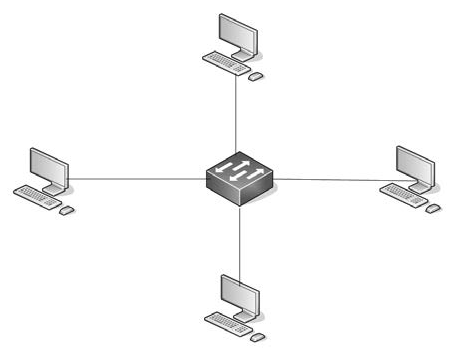
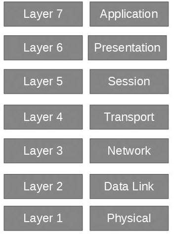
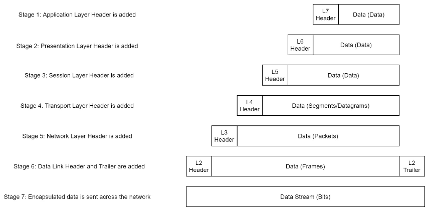
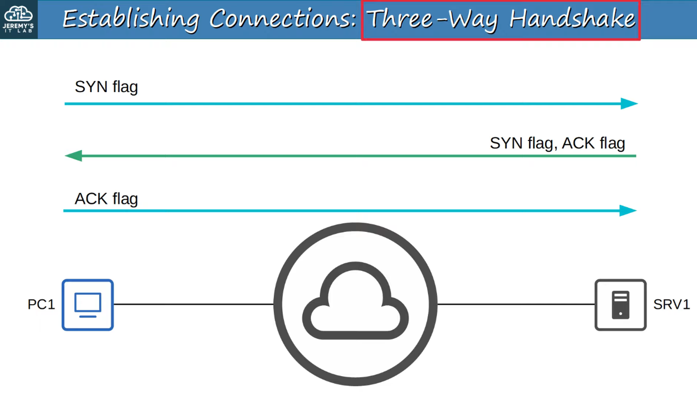

# Introductory Networking

Computer networking makes more sense to me when I picture devices exchanging information instead of trying to memorize a long list of acronyms. This page gathers the basic ideas I use to make sense of the rest of my networking notes.

A protocol is a shared set of rules for exchanging data. TCP/IP is short for Transmission Control Protocol and Internet Protocol, two of the main protocols used by Internet-connected networks.

I put this together from my course notes and Jeremy McDowell's lessons on [network devices](https://www.youtube.com/watch?v=H8W9oMNSuwo), [interfaces and cables](https://www.youtube.com/watch?v=ieTH5lVhNaY), and the [OSI model and TCP/IP suite](https://www.youtube.com/watch?v=t-ai8JzhHuY).

## What a network is

A network is a group of connected devices that can exchange data or share services. A laptop, phone, printer, server, switch, and router can all be network nodes. The endpoint devices that send or receive information are often called hosts.

“Client” and “server” describe what a device is doing in a particular exchange. A browser is a client when it asks a web server for a page. The same computer can also act as a server if it provides a service to another device.

A network printer normally has its own network connection and IP address. A printer connected directly to one computer by USB is different: that computer can share access to it.

## LANs, WANs, and layouts

A **LAN** (Local Area Network) connects devices in a limited place, such as a home, school, or office. A **WAN** (Wide Area Network) connects networks across larger distances. The Internet is a very large collection of connected networks.

In a star layout, each device connects to a central switch or access point. It is common because a problem with one device's cable usually affects that device alone. A failed central switch can affect many devices at once.

Bus and ring are older ways to arrange devices along a shared line or loop. A mesh has multiple links between devices, which can provide alternate paths but takes more equipment. These are ways to describe a network's layout; real networks can combine layouts.

## Devices and cables

- A **switch** connects wired devices in a LAN. It uses Ethernet MAC addresses to send a frame toward the right port. I explain how it learns those addresses in [Networking]({{site.baseurl}}/posts/Networking/).
- A **router** moves IP packets between different networks. A home device usually sends traffic for other networks to its default gateway, which is commonly the local router.
- A **firewall** allows or blocks traffic according to rules. It can be a separate device, part of a router, or software on a computer. Some vendors bundle features such as web filtering or malware checks into a Unified Threat Management (UTM) device.
- A **wireless access point** connects Wi-Fi devices to the wired LAN. Wi-Fi uses the IEEE 802.11 standards at the Physical and Data Link layers. The access point bridges traffic between wireless and wired sides; it is not simply a hub.
- A **modem** or fiber **ONT** connects the home network to the ISP's access service. Home gateways often combine the modem or ONT, router, switch, firewall, and wireless access point in one box.
- An old-style **hub** repeats incoming signals out its other ports. Switches replaced hubs in most Ethernet networks because a switch can forward frames based on MAC addresses.

Ethernet over copper is common for wired connections. UTP means unshielded twisted pair; twisting the wire pairs helps reduce interference. STP means shielded twisted pair and adds shielding for places where interference is a concern. Fiber carries data as light and can cover longer distances, depending on the fiber and optics used. Wi-Fi uses radio, so distance, walls, and other transmitters can affect the connection. I avoid assuming one cable type always has a fixed speed or reach; the actual limit depends on the standard and equipment.

## The OSI model

The Open Systems Interconnection (OSI) model, developed by the International Organization for Standardization (ISO), is a seven-layer map for talking about network functions. It is useful when I am trying to describe where something happens, but it is a model: real software does not always fit into seven separate boxes.

| Layer | What I associate with it |
| --- | --- |
| 7. Application | Network services used by applications, such as HTTP or DNS. |
| 6. Presentation | Data formats and representation; encryption or compression can be discussed here in the model. |
| 5. Session | Starting, managing, and ending an exchange between applications. |
| 4. Transport | Communication between applications, including ports; TCP and UDP are here. |
| 3. Network | IP addresses and routing between networks. |
| 2. Data Link | Frames and local-link addresses such as Ethernet MAC addresses. |
| 1. Physical | The signals carried over copper, fiber, or radio. |

Layers 5 and 6 are helpful ideas in the OSI model, but their jobs are often handled by application software rather than by separate layers in a TCP/IP network stack.

## The TCP/IP model

The TCP/IP model groups network functions into four layers. It is a useful view of the protocols used on the Internet.

| TCP/IP layer | Rough OSI match | Examples |
| --- | --- | --- |
| Application | OSI 5–7 | HTTP, DNS |
| Transport | OSI 4 | TCP, UDP |
| Internet | OSI 3 | IPv4, IPv6 |
| Link / Network Access | OSI 1–2 | Ethernet, Wi-Fi |

Some courses use a five-layer version by splitting the Link layer into Data Link and Physical. That is another way to teach the same path; the four-layer table above matches the model in my original notes.

## Encapsulation

As data moves down the sending device's network stack, each layer adds information it needs. The transport layer adds its header, the Internet layer adds an IP header, and the Link layer wraps the packet in a frame. An Ethernet frame also has a trailer for its error check. The physical layer sends the resulting bits as electrical, light, or radio signals.

The receiving device works back up the layers and reads or removes the information each layer added. This is called decapsulation. The names also change as the data moves: a TCP segment is carried in an IP packet, which is carried in a link-layer frame.

## How a TCP connection starts

Before a new TCP connection carries application data, the two endpoints exchange three messages. The client sends **SYN**, the server replies with **SYN-ACK**, and the client answers with **ACK**. This is the TCP three-way handshake. It sets up the connection state on both ends; it does not by itself prove that the application is working. Jeremy's [TCP lesson](https://www.youtube.com/watch?v=LIEACBqlntY) walks through the same exchange.

For the next step, see [Networking]({{site.baseurl}}/posts/Networking/), where I follow frames, MAC and IP addresses, and common network services.

## A small history note

ARPANET was an early packet-switched research network. DARPA describes its four-node network, activated in 1969, as the point when the foundation of today's Internet began taking shape ([short history](https://www.darpa.mil/news/features/arpanet)). ARPANET was a predecessor to the Internet, not the Internet we use today.
