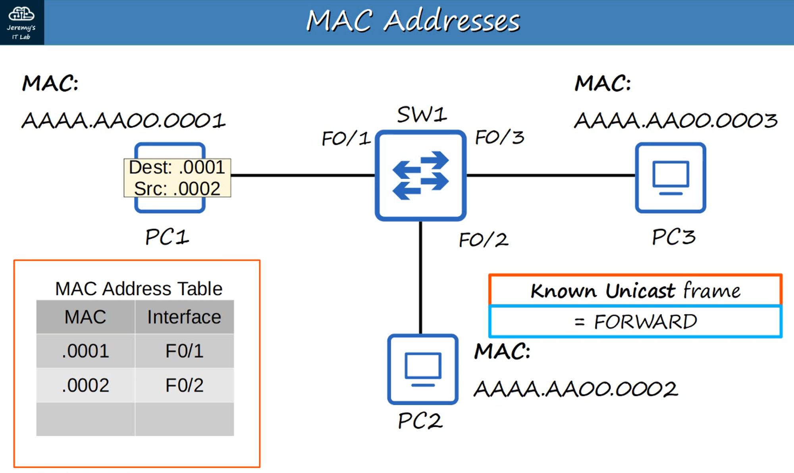
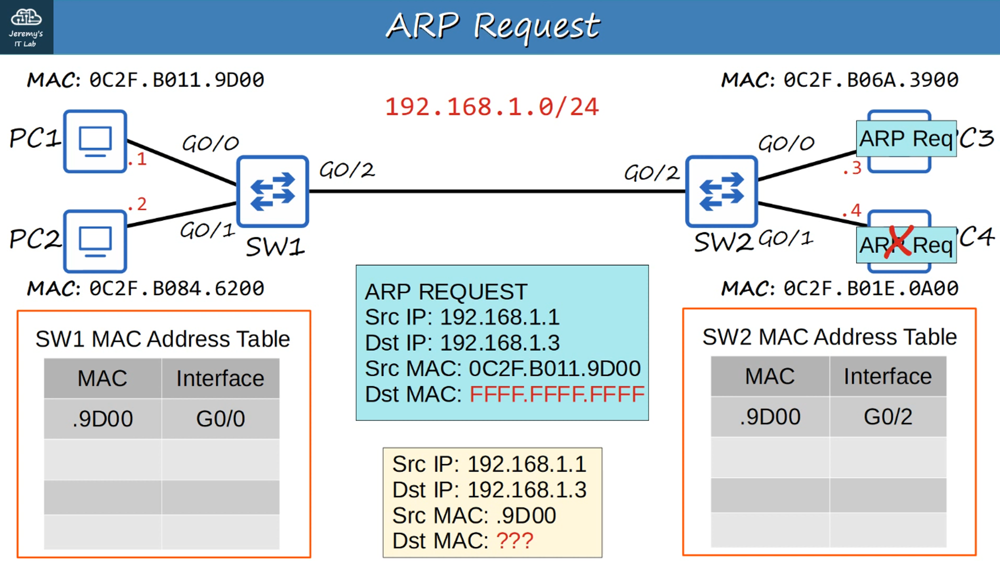
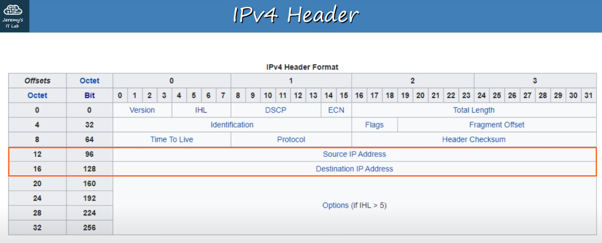
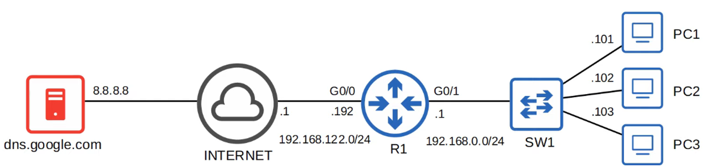
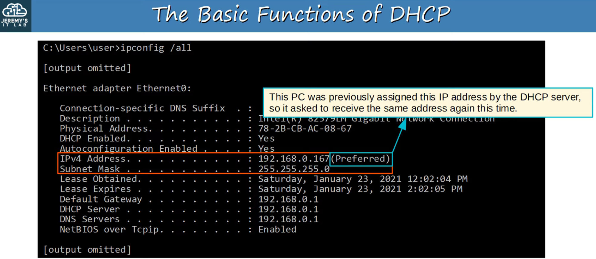

# Networking

This page picks up from [Introductory Networking]({{site.baseurl}}/posts/Introductory-Networking/). I find it easier to follow network traffic once I keep three things separate: the local frame, the IP packet, and the transport data inside it.

These are my notes from Jeremy McDowell's lessons on [Ethernet switching](https://www.youtube.com/watch?v=u2n762WG0Vo), [ARP](https://www.youtube.com/watch?v=5q1pqdmdPjo), [IPv4 addressing](https://www.youtube.com/watch?v=3ROdsfEUuhs), [the IPv4 header](https://www.youtube.com/watch?v=aQB22y4liXA), [TCP and UDP](https://www.youtube.com/watch?v=LIEACBqlntY), [DNS](https://www.youtube.com/watch?v=4C6eeQes4cs), and [DHCP](https://www.youtube.com/watch?v=hzkleGAC2_Y). I wrote the explanations in my own words and checked the protocol details against the linked standards.

## Ethernet frames and MAC addresses

On an Ethernet LAN, a network interface (sometimes called a network interface card, or NIC) sends data inside a **frame**. The frame includes a source media access control (MAC) address, a destination MAC address, the payload, and an error-check value. A MAC address is a link address used for delivery on the local network. A typical Ethernet MAC address is 48 bits and is written as six pairs of hexadecimal digits.

Some devices use locally assigned or randomized MAC addresses, so an address does not always identify one physical device permanently. For switching, the key detail is that a frame has a source and a destination MAC address.

A switch learns from the **source** MAC address of each frame it receives and remembers which port it came from. If the destination MAC is known, the switch can forward the frame to that port. If it is not known, the switch floods the frame within that VLAN (a separate local network on the switch), except out the port where it arrived. Broadcast frames are also flooded within that local VLAN.

The diagram is from Jeremy's [Ethernet LAN switching lesson](https://www.youtube.com/watch?v=u2n762WG0Vo). On Cisco IOS, `show mac address-table` displays the switch's learned MAC table. A switch's MAC table is different from a computer's ARP cache: one maps MAC addresses to switch ports, while the other maps local IPv4 next hops to MAC addresses.

## ARP: finding the next MAC address

IPv4 uses **ARP** (Address Resolution Protocol) to find the MAC address needed for the next local Ethernet hop. ARP requests are broadcast on the local link, and the device with the matching IPv4 address normally replies directly to the requester. A router does not forward an ARP broadcast to another network. This is the basic mapping described in [RFC 826](https://www.rfc-editor.org/rfc/rfc826).

This example follows Jeremy's [Ethernet LAN Switching Part 2 lesson](https://www.youtube.com/watch?v=5q1pqdmdPjo).

The destination being local or remote changes which address the computer looks up:

- If `192.168.1.10/24` needs to reach another host on `192.168.1.0/24`, it looks up that host's MAC address.
- If it needs to reach an address outside that subnet, it sends the packet to its default gateway and looks up the gateway's MAC address instead.

The router then forwards the IP packet toward the next network and uses a new link-layer frame for that hop. The IP source and destination usually stay the same along the route, unless something such as NAT changes them.

On Windows, `arp -a` shows the local ARP cache. On Linux, `ip neigh` shows the neighbor table.

## IPv4 addresses and subnet masks

The Internet Protocol comes in IPv4 and IPv6. This page focuses on IPv4. An IPv4 address is 32 bits, usually written as four decimal octets, such as `192.168.1.10`. Classless Inter-Domain Routing (CIDR) prefix notation tells me how many of those bits belong to the network. For example, `/24` means the first 24 bits are the network portion and the remaining 8 bits are for hosts. The same `/24` prefix can also be written as the subnet mask `255.255.255.0`.

For a typical `192.168.1.0/24` subnet:

| Address | Meaning |
| --- | --- |
| `192.168.1.0` | Network address |
| `192.168.1.1` to `192.168.1.254` | Common host address range |
| `192.168.1.255` | Broadcast address |

That host range is for this common `/24` example. Some prefixes have special uses, so I do not apply the same range rule to every subnet. The prefix length is the useful part to focus on when deciding whether two IPv4 addresses are local to each other.

The old class A, B, and C system appears in many networking lessons. It used these ranges and default prefixes:

| Historical class | First-octet range | Old default |
| --- | --- | --- |
| A | `1–126` | `/8` |
| B | `128–191` | `/16` |
| C | `192–223` | `/24` |
| D | `224–239` | Multicast |
| E | `240–255` | Reserved |

The `127.x.x.x` range is for loopback, and `0.x.x.x` has special uses. Modern networks use CIDR prefixes instead of choosing the subnet mask from a class. I keep the class names here as historical terms, not as the way to plan a current network. [RFC 4632](https://www.rfc-editor.org/rfc/rfc4632) describes the move to classless prefixes.

These three blocks are reserved for private IPv4 networks: `10.0.0.0/8`, `172.16.0.0/12`, and `192.168.0.0/16`. Private addresses can be reused on separate networks and should not be routed across the public Internet. A home router commonly uses Network Address Translation (NAT) to translate private addresses for Internet access. The ranges are listed in [RFC 1918](https://www.rfc-editor.org/rfc/rfc1918).

On an IPv4 LAN, **unicast** is sent to one destination, **broadcast** is sent to hosts on the local subnet, and **multicast** is sent to a group that joined that traffic. Routers do not normally forward local IPv4 broadcasts to other networks.

## What is inside an IPv4 header

The IPv4 header carries information routers need to forward a packet. I find it easier to remember the fields by connecting them to the jobs they do.

This field map comes from my CCNA notes; the explanations below follow Jeremy's [IPv4 header lesson](https://www.youtube.com/watch?v=aQB22y4liXA).

The fields I pay attention to first are:

- **Source and destination address** tell routers where the packet came from and where it is going.
- **Time to Live (TTL)** is reduced as routers forward the packet. If it reaches zero, the packet is discarded. This helps stop packets from circulating forever.
- **Protocol** identifies the kind of data carried next, such as TCP, UDP, or ICMP.
- **Total Length** counts the IPv4 header and its data together.
- **Header Checksum** checks the IPv4 header, not the packet's data. A router recalculates it when it changes a checked header field such as TTL.
- **Identification, flags, and fragment offset** are used when IPv4 fragmentation needs to be handled.

Those header details come from the [IPv4 specification, RFC 791](https://www.rfc-editor.org/rfc/rfc791). Port numbers are not in this header; they are in the TCP or UDP header that follows it.

## TCP, UDP, and ports

Transmission Control Protocol (TCP) and User Datagram Protocol (UDP) both carry application data between devices, but they provide different services. A port helps the receiving device pass that data to the right application.

| TCP | UDP |
| --- | --- |
| Sets up a connection before the application sends data. | Sends separate datagrams without a TCP-style connection setup. |
| Provides an ordered byte stream and retransmits data when needed. | Does not provide TCP-style ordering or retransmission. |
| Useful when the application needs reliable, ordered delivery. | Useful when the application wants a simpler transport and can handle any reliability it needs itself. |

TCP is not simply “slow,” and UDP is not always “fast.” The application and network conditions matter. TCP's current specification describes its service as a reliable, in-order byte stream ([RFC 9293](https://www.rfc-editor.org/rfc/rfc9293)); UDP leaves delivery and ordering decisions to the application ([RFC 768](https://www.rfc-editor.org/rfc/rfc768)).

For a new TCP connection, the client sends SYN, the server answers with SYN-ACK, and the client finishes with ACK. The handshake is pictured in [Introductory Networking]({{site.baseurl}}/posts/Introductory-Networking/).

## DNS: using names instead of memorizing addresses

DNS lets a device look up records for a name such as `example.com`. An A record can provide an IPv4 address; an AAAA record can provide an IPv6 address. One name can have several records or addresses, and the answer can change over time.

The device asks a configured DNS resolver (the server it uses to look up names). The resolver may answer from its cache or find the answer through DNS servers responsible for different parts of the name hierarchy. A local cache or hosts file can also affect an answer, but the exact lookup order depends on the operating system and application. The DNS design is described in [RFC 1034](https://www.rfc-editor.org/rfc/rfc1034). Standard DNS can use UDP or TCP on port 53 ([RFC 1035](https://www.rfc-editor.org/rfc/rfc1035)).

Jeremy's [DNS lesson](https://www.youtube.com/watch?v=4C6eeQes4cs) uses this simple layout to show that the resolver is a server the client can reach. It is not necessarily the same server that hosts the website. To ask the configured resolver for a name, I can use `nslookup example.com`. On Windows, `ipconfig /displaydns` shows the DNS cache and `ipconfig /flushdns` clears it.

## DHCP: getting network settings automatically

DHCP gives a host its network settings for a lease. These can include an IPv4 address, subnet mask, default gateway, and DNS server. The exchange is often remembered as **DORA**:

1. **Discover:** the client looks for DHCP servers.
2. **Offer:** a server offers an address and settings.
3. **Request:** the client asks to use one offer.
4. **Acknowledge:** the server confirms the lease.

The screenshot comes from Jeremy's [DHCP lesson](https://www.youtube.com/watch?v=hzkleGAC2_Y). It shows the kind of details I would check with `ipconfig /all`; it is a course example, not output from my own network. DHCP uses UDP. The server listens on port 67 and the client listens on port 68. A new client normally broadcasts its first discovery because it does not yet have an address. Offers and acknowledgments can be broadcast or unicast depending on the client's state. A DHCP relay can carry requests between a client subnet and a server on another subnet. These details are specified in [RFC 2131](https://www.rfc-editor.org/rfc/rfc2131).

On Windows, `ipconfig /release` gives up the current DHCP address and `ipconfig /renew` asks for a lease again.

## Commands I come back to

I use these to check a device's configuration or see whether a network path responds. The options and output can vary by system.

| Command | What I use it for |
| --- | --- |
| `ipconfig /all` | View Windows interface settings, including IP, gateway, DNS, and DHCP details. |
| `ip address` | View Linux interface addresses. |
| `ip route` | View Linux routes, including the default route. |
| `arp -a` | View the Windows ARP cache. |
| `ip neigh` | View Linux neighbor entries. |
| `ping example.com` | Send ICMP echo requests to check whether a host responds. |
| `nslookup example.com` | Ask a DNS resolver about a name. |
| `tracert example.com` | On Windows, show the router hops that reply along a path. |
| `traceroute example.com` | Common Linux command for seeing responding router hops. |

A reply to **ping** shows that the ICMP probe received a response; it does not prove a website or other application is working. A missing reply can also mean that ICMP is filtered. Traceroute tools depend on routers sending replies, so some hops may not appear even when traffic continues past them.
